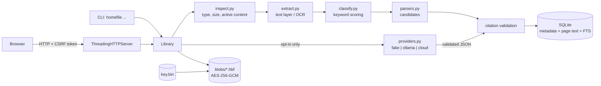

# Architecture

This document describes the implementation in `src/homefile/` as it exists. It
does not describe planned work. Where the code is weaker than the design
intent, the limitation is stated in place.

## 1. System shape

Open Home File is one Python process over one local data directory. There is
no daemon, no job queue, no background worker, and no external service in the
default configuration.

Two front ends call the same service object:

- `src/homefile/cli.py` - argument parsing and JSON or human output.
- `src/homefile/web/server.py` - a loopback HTTP server that renders HTML.

All business rules live in `src/homefile/service.py` (`Library`). The CLI and
the web layer are adapters: they validate their own input shape, call
`Library`, and format the result. Neither writes SQL and neither encrypts
anything itself.

State lives under `Settings.data_dir` (`src/homefile/config.py`):

| Path | Contents |
|---|---|
| `homefile.sqlite3` | metadata, extracted text, fields, history, reminders, ledger, deletion log; `-wal` and `-shm` sit beside it while open |
| `blobs/<sha256>.hbf` | original bytes, AES-256-GCM sealed, one file per content hash |
| `key.bin` | 32-byte master key for the blobs, created on first use |
| `exports/` | export bundles created by `export_document` |

`Library.__init__` creates the data directory, runs `db.init_db`, and
constructs `BlobStore`, which calls `crypto.load_or_create_key`. Read-only
commands therefore also create the directory, schema, and key if they are
absent.

## 2. Data-flow diagram

The provider box is part of the import path, but in the default configuration
it is `FakeProvider`, which performs no I/O and no network call.

## 3. Import pipeline

Entry points: `Library.import_file` (CLI) reads the file and delegates to
`Library.import_bytes`; the web upload handler calls `import_bytes` directly
with the bytes parsed from the multipart body.

1. **Type and size checks.** `inspect.inspect_bytes` rejects empty files and
   files larger than `Settings.max_file_bytes`. `inspect.detect_media_type`
   accepts only PDF, PNG, and JPEG magic numbers. PDFs are parsed with `pypdf`;
   the page count must be non-zero and at most `max_pages`.
   `inspect._reject_active_pdf` rejects a fixed token list (`/JavaScript`,
   `/JS`, `/Launch`, `/EmbeddedFile`, `/RichMedia`, `/XFA`, `/OpenAction`,
   `/AA`, `/SubmitForm`, `/ImportData`, `/GoToR`, `/Sound`, `/Movie`) and any
   `/Encrypt`. Images are decoded twice with Pillow and rejected above
   40,000,000 pixels, above 20,000 px per side, or below 8 px per side; nothing
   is written before these checks pass.
2. **Filename normalisation.** `inspect.safe_filename` reduces the supplied
   name to a basename, removes control characters, collapses whitespace, and
   caps the result at 200 characters.
3. **Identity and duplicate check.** SHA-256 of the exact bytes. If
   `documents.sha256` already exists, an `imports` row with status `duplicate`
   is written and the existing document is returned with a warning. No second
   blob is stored.
4. **Text extraction.** `extract.extract_pages` dispatches on media type. For
   PDFs, the embedded text layer is preferred; a page with fewer than 20
   non-whitespace characters is passed to OCR for its embedded images;
   standalone images are always OCR'd. Each page's text is normalised and
   truncated to `max_page_chars`, with a warning. When OCR is unavailable the
   page is stored with empty text and `text_source = "none"`; no text is
   invented.
5. **Blob write.** `BlobStore.put` re-hashes the bytes, seals them with
   AES-256-GCM using the content hash as associated data, writes a temporary
   file with mode 0600, fsyncs, and renames it to `<sha256>.hbf`, before the
   database transaction.
6. **Classification.** `classify.classify_text` scores keyword groups for
   receipt, warranty, bill, contract, and subscription, and returns `unknown`
   with confidence 0.0 when nothing matches. This is the only classification
   used. `_model_candidates` validates the model's `doc_type` but the service
   discards it; document type is deterministic.
7. **Field extraction.** `parsers.extract_candidates` runs label and pattern
   parsers for vendor, amount, currency, serial, purchase date, and dated
   deadlines, keeping the highest-confidence candidate per field name. A
   warranty end date can be derived from an "N year warranty" phrase; that
   candidate is marked `derived:term` and confidence 0.5.
8. **Optional model suggestions.** When `use_model` is true and the provider
   can be built, `Library._model_candidates` sends the first
   `MODEL_TEXT_LIMIT` (6000) characters to the provider and validates the JSON
   envelope. A suggestion is added only for a field name deterministic parsing
   did not produce, and only if its quote can be located in a page. Confidence
   is capped at `MODEL_CONFIDENCE_CEILING` (0.6).
9. **Citation validation.** Every candidate must satisfy `_citation_valid`:
   the cited page exists and `0 <= char_start < char_end <= len(page.text)`. A
   failing candidate is dropped with a warning. For model suggestions,
   `_locate_quote` tries an exact substring, then a whitespace-collapsed
   search.
10. **Transactional write.** One `db.transaction` inserts the `documents` row,
    one `pages` row per page (FTS triggers index it), one `fields` row per
    accepted candidate, a `field_history` row with action `extracted`, any
    reminders, and the `imports` row; any exception rolls back.
11. **Reminder suggestion.** For each field whose name maps to a reminder kind
    and whose value parses as a date, a reminder is inserted with status
    `suggested`, an earlier due date, and a note; suggested reminders are never
    due.

Failure behaviour: validation errors become an `imports` row with status
`failed` and an error class, then re-raise; unexpected exceptions record the
exception type as the error. A failure after blob write but before commit
leaves an orphan `.hbf`, which `verify_integrity` reports.

## 4. Trust boundaries per step

| Step | Boundary | Untrusted input | Control |
|---|---|---|---|
| Upload | browser to loopback server | multipart body, filename, field values | body cap of 20 × `max_file_bytes` + 1 MiB, 20-file cap, `parse_multipart`, `safe_filename`, CSRF check |
| Import | caller to service | bytes and filename | `inspect.inspect_bytes`, magic-number allowlist, size/page/pixel limits |
| Parsing | service to `pypdf`/Pillow/Tesseract | file bytes | type checks, page cap, page-char cap, pixel caps; no sandbox |
| Model call | service to provider | document text in the prompt | disabled unless opted in; 6000-char cap; output schema validation; quote must be in the page |
| Persistence | service to SQLite | field values, search input | bound parameters; filter SQL assembled only from literals |
| Blob storage | service to filesystem | original bytes | AES-GCM with hash AAD; path built from a validated 64-hex hash |
| Rendering | service data to HTML | filenames, page text, field values, errors | `render.esc` in every template path; CSP; `nosniff` |
| Export | service to filesystem | filename inside zip | basename only; bundle written under `exports/` |
| Deletion | service to filesystem | document id | id is server-generated; removal verified by queries and file checks |

## 5. Module map

| File | Responsibility |
|---|---|
| `src/homefile/config.py` | `Settings` dataclass, environment parsing, data-dir resolution and derived paths |
| `src/homefile/errors.py` | Exception taxonomy used for user-visible failures |
| `src/homefile/models.py` | Dataclasses and enums: `Document`, `Page`, `Citation`, `ExtractedField`, `Reminder`, `DeletionReport` |
| `src/homefile/db.py` | Schema, FTS triggers, connection pragmas, transaction helpers, migrations to version 3 |
| `src/homefile/crypto.py` | `HBF1` at-rest sealing, `HFE1` passphrase export sealing, key generation and loading |
| `src/homefile/store.py` | Content-addressed encrypted blob store |
| `src/homefile/inspect.py` | Pre-parse validation, media detection, safe filenames |
| `src/homefile/extract.py` | PDF text layer and OCR adapters, per-page truncation |
| `src/homefile/parsers.py` | Pure date, amount, vendor, serial, and deadline parsers producing candidates with citations |
| `src/homefile/classify.py` | Deterministic keyword classification |
| `src/homefile/providers.py` | Provider protocol, fake/Ollama/cloud adapters, budget guard, ledger writes, output validation |
| `src/homefile/service.py` | `Library`: import, read, search, corrections, reminders, export, delete, verify, stats |
| `src/homefile/cli.py` | Command-line surface over `Library` |
| `src/homefile/smoke.py` | End-to-end scenario over synthetic fixtures |
| `src/homefile/fixtures.py` | Deterministic synthetic PDF and PNG generation |
| `src/homefile/web/server.py` | HTTP routing, multipart parsing, CSRF/origin checks, security headers, loopback binding |
| `src/homefile/web/pages.py` | Server-rendered pages for home, documents, detail, delete, reminders, settings |
| `src/homefile/web/render.py` | Escaping and shared HTML fragments |
| `src/homefile/web/static/` | Three static assets: `tokens.css`, `app.css`, `app.js` |

