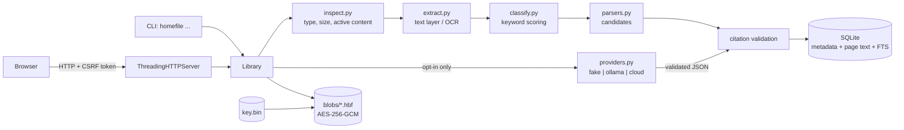

# Architecture

This document describes the implementation in `src/homefile/` as it exists. It
does not describe planned work. Where the code is weaker than the design
intent, the limitation is stated in place.

## 1. System shape

Open Home File is one Python process over one local data directory. There is
no daemon, no job queue, no background worker, and no external service in the
default configuration.

Two front ends call the same service object:

- `src/homefile/cli.py` - argument parsing and JSON or human output.
- `src/homefile/web/server.py` - a loopback HTTP server that renders HTML.

All business rules live in `src/homefile/service.py` (`Library`). The CLI and
the web layer are adapters: they validate their own input shape, call
`Library`, and format the result. Neither writes SQL and neither encrypts
anything itself.

State lives under `Settings.data_dir` (`src/homefile/config.py`):

| Path | Contents |
|---|---|
| `homefile.sqlite3` | metadata, extracted text, fields, history, reminders, ledger, deletion log; `-wal` and `-shm` sit beside it while open |
| `blobs/<sha256>.hbf` | original bytes, AES-256-GCM sealed, one file per content hash |
| `key.bin` | 32-byte master key for the blobs, created on first use |
| `exports/` | export bundles created by `export_document` |

`Library.__init__` creates the data directory, runs `db.init_db`, and
constructs `BlobStore`, which calls `crypto.load_or_create_key`. Read-only
commands therefore also create the directory, schema, and key if they are
absent.

## 2. Data-flow diagram

The provider box is part of the import path, but in the default configuration
it is `FakeProvider`, which performs no I/O and no network call.

## 3. Import pipeline

Entry points: `Library.import_file` (CLI) reads the file and delegates to
`Library.import_bytes`; the web upload handler calls `import_bytes` directly
with the bytes parsed from the multipart body.

1. **Type and size checks.** `inspect.inspect_bytes` rejects empty files and
   files larger than `Settings.max_file_bytes`. `inspect.detect_media_type`
   accepts only PDF, PNG, and JPEG magic numbers. PDFs are parsed with `pypdf`;
   the page count must be non-zero and at most `max_pages`.
   `inspect._reject_active_pdf` rejects a fixed token list (`/JavaScript`,
   `/JS`, `/Launch`, `/EmbeddedFile`, `/RichMedia`, `/XFA`, `/OpenAction`,
   `/AA`, `/SubmitForm`, `/ImportData`, `/GoToR`, `/Sound`, `/Movie`) and any
   `/Encrypt`. Images are decoded twice with Pillow and rejected above
   40,000,000 pixels, above 20,000 px per side, or below 8 px per side; nothing
   is written before these checks pass.
2. **Filename normalisation.** `inspect.safe_filename` reduces the supplied
   name to a basename, removes control characters, collapses whitespace, and
   caps the result at 200 characters.
3. **Identity and duplicate check.** SHA-256 of the exact bytes. If
   `documents.sha256` already exists, an `imports` row with status `duplicate`
   is written and the existing document is returned with a warning. No second
   blob is stored.
4. **Text extraction.** `extract.extract_pages` dispatches on media type. For
   PDFs, the embedded text layer is preferred; a page with fewer than 20
   non-whitespace characters is passed to OCR for its embedded images;
   standalone images are always OCR'd. Each page's text is normalised and
   truncated to `max_page_chars`, with a warning. When OCR is unavailable the
   page is stored with empty text and `text_source = "none"`; no text is
   invented.
5. **Blob write.** `BlobStore.put` re-hashes the bytes, seals them with
   AES-256-GCM using the content hash as associated data, writes a temporary
   file with mode 0600, fsyncs, and renames it to `<sha256>.hbf`, before the
   database transaction.
6. **Classification.** `classify.classify_text` scores keyword groups for
   receipt, warranty, bill, contract, and subscription, and returns `unknown`
   with confidence 0.0 when nothing matches. This is the only classification
   used. `_model_candidates` validates the model's `doc_type` but the service
   discards it; document type is deterministic.
7. **Field extraction.** `parsers.extract_candidates` runs label and pattern
   parsers for vendor, amount, currency, serial, purchase date, and dated
   deadlines, keeping the highest-confidence candidate per field name. A
   warranty end date can be derived from an "N year warranty" phrase; that
   candidate is marked `derived:term` and confidence 0.5.
8. **Optional model suggestions.** When `use_model` is true and the provider
   can be built, `Library._model_candidates` sends the first
   `MODEL_TEXT_LIMIT` (6000) characters to the provider and validates the JSON
   envelope. A suggestion is added only for a field name deterministic parsing
   did not produce, and only if its quote can be located in a page. Confidence
   is capped at `MODEL_CONFIDENCE_CEILING` (0.6).
9. **Citation validation.** Every candidate must satisfy `_citation_valid`:
   the cited page exists and `0 <= char_start < char_end <= len(page.text)`. A
   failing candidate is dropped with a warning. For model suggestions,
   `_locate_quote` tries an exact substring, then a whitespace-collapsed
   search.
10. **Transactional write.** One `db.transaction` inserts the `documents` row,
    one `pages` row per page (FTS triggers index it), one `fields` row per
    accepted candidate, a `field_history` row with action `extracted`, any
    reminders, and the `imports` row; any exception rolls back.
11. **Reminder suggestion.** For each field whose name maps to a reminder kind
    and whose value parses as a date, a reminder is inserted with status
    `suggested`, an earlier due date, and a note; suggested reminders are never
    due.

Failure behaviour: validation errors become an `imports` row with status
`failed` and an error class, then re-raise; unexpected exceptions record the
exception type as the error. A failure after blob write but before commit
leaves an orphan `.hbf`, which `verify_integrity` reports.

## 4. Trust boundaries per step

| Step | Boundary | Untrusted input | Control |
|---|---|---|---|
| Upload | browser to loopback server | multipart body, filename, field values | body cap of 20 × `max_file_bytes` + 1 MiB, 20-file cap, `parse_multipart`, `safe_filename`, CSRF check |
| Import | caller to service | bytes and filename | `inspect.inspect_bytes`, magic-number allowlist, size/page/pixel limits |
| Parsing | service to `pypdf`/Pillow/Tesseract | file bytes | type checks, page cap, page-char cap, pixel caps; no sandbox |
| Model call | service to provider | document text in the prompt | disabled unless opted in; 6000-char cap; output schema validation; quote must be in the page |
| Persistence | service to SQLite | field values, search input | bound parameters; filter SQL assembled only from literals |
| Blob storage | service to filesystem | original bytes | AES-GCM with hash AAD; path built from a validated 64-hex hash |
| Rendering | service data to HTML | filenames, page text, field values, errors | `render.esc` in every template path; CSP; `nosniff` |
| Export | service to filesystem | filename inside zip | basename only; bundle written under `exports/` |
| Deletion | service to filesystem | document id | id is server-generated; removal verified by queries and file checks |

## 5. Module map

| File | Responsibility |
|---|---|
| `src/homefile/config.py` | `Settings` dataclass, environment parsing, data-dir resolution and derived paths |
| `src/homefile/errors.py` | Exception taxonomy used for user-visible failures |
| `src/homefile/models.py` | Dataclasses and enums: `Document`, `Page`, `Citation`, `ExtractedField`, `Reminder`, `DeletionReport` |
| `src/homefile/db.py` | Schema, FTS triggers, connection pragmas, transaction helpers, migrations to version 3 |
| `src/homefile/crypto.py` | `HBF1` at-rest sealing, `HFE1` passphrase export sealing, key generation and loading |
| `src/homefile/store.py` | Content-addressed encrypted blob store |
| `src/homefile/inspect.py` | Pre-parse validation, media detection, safe filenames |
| `src/homefile/extract.py` | PDF text layer and OCR adapters, per-page truncation |
| `src/homefile/parsers.py` | Pure date, amount, vendor, serial, and deadline parsers producing candidates with citations |
| `src/homefile/classify.py` | Deterministic keyword classification |
| `src/homefile/providers.py` | Provider protocol, fake/Ollama/cloud adapters, budget guard, ledger writes, output validation |
| `src/homefile/service.py` | `Library`: import, read, search, corrections, reminders, export, delete, verify, stats |
| `src/homefile/cli.py` | Command-line surface over `Library` |
| `src/homefile/smoke.py` | End-to-end scenario over synthetic fixtures |
| `src/homefile/fixtures.py` | Deterministic synthetic PDF and PNG generation |
| `src/homefile/web/server.py` | HTTP routing, multipart parsing, CSRF/origin checks, security headers, loopback binding |
| `src/homefile/web/pages.py` | Server-rendered pages for home, documents, detail, delete, reminders, settings |
| `src/homefile/web/render.py` | Escaping and shared HTML fragments |
| `src/homefile/web/static/` | Three static assets: `tokens.css`, `app.css`, `app.js` |

## 6. Data model

The schema in `db.SCHEMA` is authoritative. All tables are `STRICT`.

- `schema_meta(key TEXT PK, value TEXT NOT NULL)` - schema version; `init_db`
  migrates version 1 by adding `reminders.confirmed_by` and `deletion_log.actor`.
- `documents(id TEXT PK, sha256 TEXT, filename TEXT, media_type TEXT, size_bytes
  INTEGER, page_count INTEGER, doc_type TEXT, doc_type_confidence REAL,
  imported_at TEXT, title TEXT)` - one row per imported file. `sha256` is not
  unique; duplicate detection is a service query.
- `pages(id INTEGER PK, doc_id TEXT FK ON DELETE CASCADE, page_no INTEGER, text
  TEXT, text_source TEXT, width REAL, height REAL, UNIQUE(doc_id, page_no))` -
  extracted text, plaintext.
- `pages_fts` - FTS5 external-content index over `pages.text`, tokenizer
  `unicode61 remove_diacritics 2`, `content_rowid='id'`; triggers `pages_ai`,
  `pages_ad`, `pages_au` keep it in sync on insert, delete, and update.
- `fields(id TEXT PK, doc_id TEXT FK ON DELETE CASCADE, name TEXT, value TEXT,
  normalized TEXT, page_no INTEGER, char_start INTEGER, char_end INTEGER, x0 REAL,
  y0 REAL, x1 REAL, y1 REAL, confidence REAL, source TEXT, status TEXT,
  original_value TEXT, version INTEGER, created_at TEXT, updated_at TEXT)` -
  extracted values with citation and provenance; indexed on `doc_id` and `name`.
- `field_history(id INTEGER PK, field_id TEXT, action TEXT, old_value TEXT,
  new_value TEXT, reason TEXT, actor TEXT, at TEXT)` - append-only by
  convention; no foreign key, so deletion removes history explicitly.
- `reminders(id TEXT PK, doc_id TEXT FK ON DELETE CASCADE, field_id TEXT, kind
  TEXT, due_date TEXT, status TEXT, confidence REAL, page_no INTEGER, note TEXT,
  created_at TEXT, confirmed_at TEXT, confirmed_by TEXT)` - indexed on
  `(due_date, status)`; stores only the page number, the citation lives on the
  field.
- `ledger(id INTEGER PK, run_id TEXT, project TEXT, workflow TEXT, provider TEXT,
  model TEXT, request_id TEXT, started_at TEXT, input_tokens INTEGER,
  output_tokens INTEGER, estimated_cost TEXT, cache_hit INTEGER, success INTEGER,
  error_class TEXT)` - one row per provider attempt, including failures; no
  prompt or document text.
- `deletion_log(id INTEGER PK, doc_id TEXT, sha256 TEXT, deleted_at TEXT, removed
  TEXT, verified INTEGER, remaining TEXT, actor TEXT)` - JSON arrays in
  `removed` and `remaining`.
- `imports(id TEXT PK, sha256 TEXT, filename TEXT, imported_at TEXT, doc_id TEXT,
  status TEXT, error TEXT)` - statuses `imported`, `duplicate`, `failed`.

Connections set `foreign_keys=ON`, `journal_mode=WAL`, `synchronous=FULL`,
`trusted_schema=OFF`, and a 15-second busy timeout. Transactions use
`BEGIN IMMEDIATE`.

## 7. Citation model

`models.Citation` is `page`, `char_start`, `char_end`, and an optional
`x0/y0/x1/y1` box. The schema stores the box columns, but the extractors never
populate them, so citations are character offsets only.

- Offsets are into stored page text after `extract._clean` and truncation, not
  into the original PDF byte stream.
- The quote is not stored separately; it is `page.text[char_start:char_end]`,
  which the detail page highlights and `Page.excerpt` expands by 80 characters.
- Validation is a range check, not a content check. Deterministic parsers build
  offsets from the string they matched, so their spans are exact. Model quotes
  are checked for presence, but the whitespace-collapsed fallback in
  `_locate_quote` returns `(page, 0, len(collapsed))`; the stored span then
  starts at 0 and may not cover the quote, so the UI can highlight the wrong
  region.
- `delete_document` verifies removal by counting the deleted pages' own rows in
  `pages_fts` (`rowid IN (...)`); it does not compare byte offsets.

## 8. Search

`Library.search` has two independent paths.

Text search uses FTS5. `_fts_query` extracts up to eight alphanumeric tokens,
including Latin-1 accented letters, and builds `token*` terms joined with
`AND`; this strips FTS operators, so user input cannot inject MATCH syntax. The
query joins `pages_fts` to `pages` on `rowid = pages.id` and to `documents` on
`doc_id`, orders by `rank`, and builds a snippet with
`snippet(pages_fts, 0, '[', ']', ' … ', 12)`. Hits are de-duplicated by
`(doc_id, page_no)`.

Structured filters use the `fields` table: exact field name plus `LIKE` on
`value` for vendor, `LIKE` on upper-cased `normalized` for serial,
`CAST(normalized AS REAL)` bounds for amount, a date range over the four
deadline field names, and exact `doc_type`. Filters combine with AND at the
document level: each one becomes a correlated subquery
`d.id IN (SELECT doc_id FROM fields f WHERE ...)`, so a document must have a
field satisfying every constraint, though those fields may be different rows.
The SQL skeleton is assembled from string literals; every user value is a bound
parameter.

A text query combined with filters is intersected: the FTS match is restricted
to documents satisfying every field constraint. Without a text query, each
matching document yields one hit citing the field from the first supplied
filter, so the result link opens that field's citation. With no query and no
filters, `search` lists every document using the first page's number and a
whitespace-collapsed 160-character preview, optionally narrowed by document
type; the web UI uses this so browsing needs no second endpoint.

The index is plaintext and lives in the same SQLite file as the rest of the
metadata (see `docs/threat-model.md`).

## 9. Web request/response cycle

`HomeFileServer` is a `ThreadingHTTPServer` with `daemon_threads` and one
`Handler` per request, plus one process-wide CSRF token generated at startup.

Every response passes through `Handler._send`, which sets `Content-Type`,
`Content-Length`, `nosniff`, `Referrer-Policy: same-origin`, `X-Frame-Options:
DENY`, a self-hosted-only CSP, and a `homefile_csrf` cookie with `HttpOnly;
SameSite=Strict` (no `Secure`, because the server is plain HTTP on loopback).

GET: `/` (`home_page`), `/documents` (`documents_page` with query and filter
parameters), `/reminders`, `/settings` (`settings_page`, which also runs
`verify_integrity`), `/documents/<id>` (`document_page`, optional `?field=`),
`/documents/<id>/delete`, `/documents/<id>/original` (decrypted attachment),
`/healthz` (literal `{"ok":true}`), and `/static/<name>` (allowlist of
`tokens.css`, `app.css`, `app.js`).

POST: `/import` (up to 20 files), `/settings/delete-all` and
`/documents/<id>/delete` (both require typing `DELETE`),
`/documents/<id>/correct` (requires a reason), `/confirm`, `/reject`,
`/export`, and `/documents/<id>/reminders/<rid>/confirm`, `/dismiss`, `/done`,
`/snooze` (1-365 days). Every POST requires the CSRF token in the form and in
the cookie and passes `_same_origin` first.

Handling order is: read and parse the body (capped at 20 × `max_file_bytes` +
1 MiB, about 501 MiB by default), check `Sec-Fetch-Site` and `Origin`, check
the token, dispatch. The whole body is read into memory before the origin
check. Errors map to 404 (`NotFound`), 400 (`HomeFileError`, `MultipartError`),
or 500 with a generic message. There is no JSON API other than `/healthz`.

HTML is assembled with f-strings. `render.esc` escapes every value from a
document, the database, a query parameter, or an exception;
`render.highlight` escapes text before wrapping the cited span in `<mark>`. The
CSP forbids inline script and style, and `app.js` is progressive enhancement
only. `serve` refuses any host other than `127.0.0.1`, `localhost`, or `::1`.

## 10. Provider boundary

The boundary is `providers.ModelProvider` (`complete`, `count_tokens`,
`stream`), wrapped by `ProviderGuard`.

- `build_provider` returns `FakeProvider` for `provider=fake` regardless of
  network settings; any other provider requires `HOMEFILE_ALLOW_NETWORK=1`.
- `cloud` also requires a base URL, model, both per-1k prices, non-zero per-run
  and daily cost caps, and an API key in the configured environment variable.
- `ProviderGuard` enforces per-run request and token caps and, for cloud,
  projected per-run and daily cost caps. It writes one ledger row per attempt,
  success or failure. A zero cost cap refuses every paid call.

Model output is a draft. `validate_extraction_payload` requires a JSON object
with an allowed `doc_type` and a list of fields; entries with an unknown name,
missing value, or empty quote are dropped and counted in `dropped`. The service
requires the quote to exist in the cited page before creating a field. The model
cannot create a reminder; reminders are derived from stored fields by
`parsers.reminder_kind_for`.

## 11. Known limitations

- SQLite and the FTS index are plaintext; only original blobs are encrypted,
  and the key sits next to the ciphertext in `key.bin`. There is no key
  rotation, re-encryption, or passphrase protection for the library key.
- There is no authentication on the web UI; any local process that can reach
  the loopback port can act as the user.
- The PDF active-content check is a byte-token scan, not a parser sandbox.
  There is no antivirus and no sandbox around `pypdf`, Pillow, or Tesseract.
- Classification is keyword scoring only; the model's document type is
  validated and ignored, and bounding boxes are in the model and schema but
  never populated.
- Deletion is logical removal and unlinking, not secure erasure.
